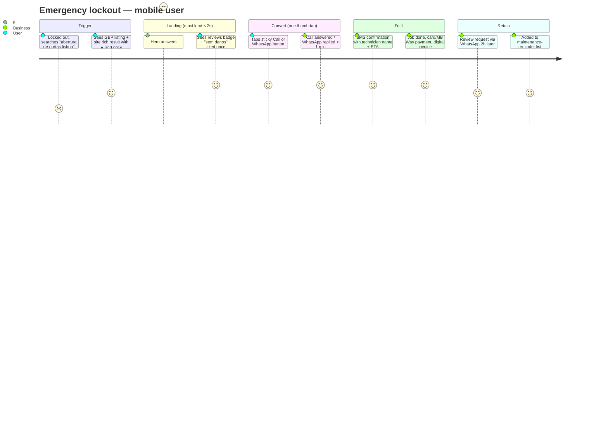
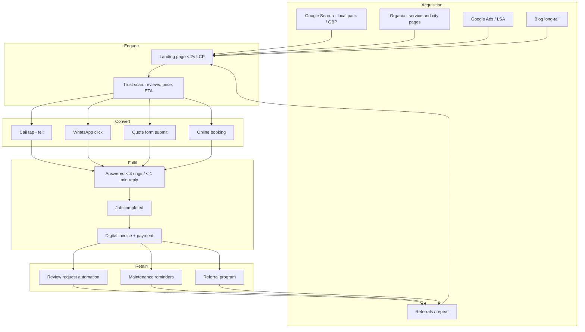

# 01 — Market Research Synthesis, Positioning & Conversion Strategy

> Part of the **{Brand} Locksmith Website Architecture** — index: [[00-index]]. Next: [[02-information-architecture]].
> `{Brand}` is a placeholder for the final brand name. Recommendation: a short, brandable Portuguese name paired with a keyword-rich domain (e.g. `chaveiro{brand}.pt` or `{brand}.pt` + exact-match service URLs). Avoid pure exact-match domains (`aberturadeportas24h.pt`) — they cap brand growth and trust.

---

## 1. Competitive research findings (PT, UK, US, DE, AU)

Live analysis of top-ranking locksmith sites per market (July 2026). Key sites analyzed: `aberturadeporta24horas.pt`, `sos-fechaduras.pt`, `chaveiro24hlisboa.pt`, `chaveirorapido.pt` (PT); `keytek.co.uk`, `locksmiths.co.uk` (MLA), `barrybros.com`, `londonlocksmith24h.co.uk` (UK); `mr-locks.com`, `safehouselocksmith.com`, `paragonsecurityny.com` (US); `schluesseldienst-muenchen.de`, `kettritz.de` (DE); `alltimelocksmiths.com.au`, `britlock.com.au` (AU).

### 1.1 What the winners do (patterns to adopt)

| Pattern | Best-in-class example | Adopt as |
|---|---|---|
| Giant `tel:` button + problem-first headline in hero | keytek.co.uk, sos-fechaduras.pt | Hero standard on every page |
| Phone number repeated 5–8× per page | kettritz.de, britlock.com.au | Header, hero, mid-page, FAQ, footer, sticky bar |
| Concrete response-time promise ("20–30 min") | schluesseldienst-muenchen.de, alltimelocksmiths.com.au | Hero + location pages with per-area ETA |
| **Published fixed-price table (Festpreis)** incl. night/weekend surcharges | schluesseldienst-muenchen.de (€52–€125 table) | Full `/precos/` page + per-service price anchors |
| Anti-scam education + counter-signals (local landline, owner's face, "no call center", card payments accepted) | kettritz.de "Vorsicht Abzocke", MLA guidance | Dedicated trust content — locksmith overcharging is a known fear in PT too |
| License/registration numbers displayed on-page | paragonsecurityny.com (#1395130), alltimelocksmiths (NSW licence in hero) | NIF, Alvará/IMPIC, insurance policy number in footer + trust pages |
| Neighborhood-level location pages (borough/Bezirk/suburb) | safehouselocksmith.com, schluesseldienst-muenchen.de (25 district pages) | Freguesia-level pages for Lisbon |
| Per-area phone numbers for call attribution | safehouselocksmith.com (212/718 per borough) | Dynamic number insertion via call tracking (optional Phase 3) |
| Review badge with count in hero | sos-fechaduras.pt ("4.9 ★ 2.549 avaliações") | Live Google-review widget, hero + footer |
| Lock-brand logo strip (Yale, Mul-T-Lock, TESA, CISA…) | sos-fechaduras.pt, barrybros.com | Trust strip component |
| Trade-association trust marks | MLA (UK), ALOA (US), MLAA (AU), Handwerkskammer (DE) | PT equivalents: DGEG, IMPIC, ANIEER; Livro de Reclamações badge |
| Photo-upload triage form with urgency selector | britlock.com.au | Quote form with photo upload |
| Job-log blog posts (real jobs with photos) | londonlocksmith24h.co.uk `/our-jobs/` | "Trabalhos Recentes" content stream — powerful E-E-A-T |

### 1.2 Market-wide gaps (our unfair advantages)

Every one of these was **absent from all or nearly all** top-ranking competitors — they are the strategy:

1. **Schema.org markup — effectively zero adoption.** None of the 15 sites fetched had meaningful JSON-LD. Schema.org has a dedicated `Locksmith` LocalBusiness subtype. Full structured-data coverage alone is a ranking/rich-result moat.
2. **WhatsApp done properly.** Portuguese users are WhatsApp-native, yet only ~half of PT competitors have any WhatsApp link, and none have pre-filled contextual messages, tracking, or a floating widget. **WhatsApp-first is our #1 conversion play.**
3. **Pricing transparency.** Hidden prices everywhere except Germany. Publishing a clear price table (the German Festpreis model) directly attacks the biggest customer fear in this vertical: being scammed.
4. **Reviews integration.** PT sites show static claims; none embed live Google reviews or run review-request automation.
5. **Multilingual.** No Lisbon locksmith serves EN/ES/FR — despite Lisbon's tourist volume, expat population, and Airbnb density. Tourists locked out of rentals are a high-value, zero-competition segment.
6. **Freguesia-level pages with genuine local content.** Only one PT competitor does neighborhood pages, and they're thin.
7. **Content/topical authority.** PT blogs are empty (0–3 posts). Long-tail queries like "como abrir porta trancada" are uncontested.
8. **Forms, booking, estimators, chatbots.** No competitor in any market had an instant estimator, online booking with slots, or live chat. Phone-first is correct, but a second path captures the ~15% who won't call.
9. **Consistency.** Competitors show contradictory hours (8:00–21:00 listed under a "24h" claim), placeholder images, broken counters. Basic polish wins trust.
10. **Payment-method signaling.** "Aceitamos MB Way, Multibanco, cartão" is almost never stated — yet card acceptance is a documented anti-scam counter-signal (scammers demand cash).

### 1.3 Industry conversion benchmarks (emergency home services)

- **84% of home-service conversions are mobile click-to-call**; design mobile phone-first.
- Emergency calls convert at **80–90%** (vs 40–60% scheduled work) — every second of friction on the call path is expensive.
- **~28% of demand arrives after-hours** — 24/7 answering (human or AI) is a revenue requirement, not a feature.
- +1 second of page load ≈ **−17% conversion**; caller patience ≈ 2.3 s.
- A missed emergency call ≈ €150–400 immediate job value plus lifetime/referral value.

---

## 2. Positioning strategy

**Category:** "O chaveiro de confiança de Lisboa" — the *trustworthy* locksmith, in a market where the default emotion is fear of being overcharged.

**Five positioning pillars** (each maps to site features):

| Pillar | Promise | Site expression |
|---|---|---|
| 1. Transparência total | "Preços fixos publicados. Sem surpresas." | `/precos/` price table, price anchors on every service page, anti-scam guide |
| 2. Rapidez comprovada | "Em Lisboa em 20–30 minutos, 24/7" | Per-area ETA on location pages, live response-time indicator |
| 3. Confiança verificável | NIF, seguro, certificações, avaliações reais | Live Google reviews, license/insurance pages, technician profiles with photos |
| 4. Contacto sem fricção | "Ligue, mande WhatsApp, ou peça orçamento em 30 segundos" | Floating WhatsApp, sticky call bar, 3-field quote form |
| 5. Para todos | PT / EN / ES / FR | Full multilingual site; tourist/Airbnb landing content |

**Audience → primary conversion path:**

| Segment | Situation | Primary CTA | Secondary |
|---|---|---|---|
| Homeowner / resident, locked out | Panic, mobile, on the street | **Call** | WhatsApp |
| Homeowner, planned work (lock change, smart lock) | Research mode, comparison | **WhatsApp / quote form** | Call |
| Driver locked out of car | Panic, roadside, mobile | **Call** | WhatsApp with photo |
| Tourist locked out (EN/ES/FR) | Panic + language barrier | **WhatsApp** (text > call for non-PT speakers) | Call |
| Airbnb host (often remote) | Guest locked out, host abroad | **WhatsApp** + online payment link | Call |
| Business / property manager / hotel | Procurement mode, B2B | **Quote form / email** | Call, Calendly |

---

## 3. User journeys

### 3.1 Emergency journey (70–80% of revenue)



**Design rules derived:** answer *who/how fast/how much* within the first viewport; call + WhatsApp reachable by thumb at all times; nothing (cookie banner, popup, animation) may delay or cover the CTAs; page interactive < 2 s on 4G.

### 3.2 Planned-work journey (research mode)

```mermaid
flowchart LR
    A[Google: "fechadura inteligente preço"] --> B[Blog article / buying guide]
    B --> C[Service page: Fechaduras Inteligentes]
    C --> D{Trust check}
    D --> E[/precos/ + reviews + about]
    E --> F[Quote form or WhatsApp]
    F --> G[Quote in < 1h via WhatsApp]
    G --> H[Booking confirmed - Calendly/booking flow]
```

### 3.3 B2B journey (property managers, hotels, Airbnb)

Landing on dedicated B2B segment pages (`/empresas/`, `/alojamento-local/`) → case studies → contract/quote form → CRM pipeline → account manager. Longer cycle; email + Calendly matter here, not sticky call bars.

---

## 4. Conversion funnel & measurement



### 4.1 KPI targets

| Stage | Metric | Target |
|---|---|---|
| Acquisition | Local-pack position, Lisbon core terms | Top 3 within 9 months |
| Engage | Mobile LCP (p75) | < 2.0 s |
| Engage | Bounce on emergency pages | < 45% |
| Convert | Visit → contact action (call+WA+form) | ≥ 12% on emergency pages, ≥ 5% site-wide |
| Convert | WhatsApp share of contacts | ≥ 35% (differentiator KPI) |
| Fulfil | Call answer rate | ≥ 95% incl. after-hours |
| Retain | Review request → review conversion | ≥ 25%; +15 Google reviews/month |

### 4.2 GA4 / GTM event schema

All CTAs fire structured events via GTM `dataLayer`. Naming convention: `{action}_{channel}` with common params.

| Event | Trigger | Key params |
|---|---|---|
| `click_call` | any `tel:` tap | `cta_location` (hero/sticky/header/footer/faq), `page_type`, `service`, `city` |
| `click_whatsapp` | WA button/widget | same + `prefill_variant` |
| `form_start` / `form_submit` | quote form | `form_type` (quote/emergency/b2b), `has_photo` |
| `estimate_completed` | price estimator | `service`, `estimate_range` |
| `booking_confirmed` | booking flow | `service`, `slot_lead_time` |
| `emergency_banner_click` | top banner | `page_type` |
| `review_widget_expand`, `exit_intent_shown/converted`, `pwa_install` | engagement | — |

Mark `click_call`, `click_whatsapp`, `form_submit`, `booking_confirmed` as GA4 **key events**; import into Google Ads as conversions. Add call tracking (e.g. CallRail or PT-local equivalent, dynamic number insertion) in Phase 3 to close the loop from keyword → answered call → job value.

---

## 5. CRO playbook (page-level requirements)

Every requirement below is a build-time acceptance criterion, not a suggestion:

1. **Sticky mobile CTA bar** — full-width, bottom-fixed, split 50/50: `📞 Ligar Agora` (green) | `WhatsApp` (WA green). Visible on every page except during form input. Safe-area aware (iOS).
2. **Sticky desktop header** — phone number as text (memorable) + WhatsApp button + "Orçamento Grátis".
3. **Emergency banner** — thin top strip on service/location pages: `🚨 Emergência? Estamos abertos agora · Chegada 20–30 min · 963 000 000`. Time-aware copy ("Aberto agora — resposta imediata" vs "Serviço noturno ativo — taxa noturna aplicável" after 22h; honesty builds trust).
4. **Response-time indicator** — component showing current status: `● Disponível agora · Tempo médio de chegada em {bairro}: 25 min`. Backed by real config per area (see availability service, doc 04).
5. **Trust bar under hero** — 4 items: ★4.9 Google (live count) · Preço fixo sem surpresas · Técnicos certificados & segurados · Pagamento MB Way/cartão.
6. **Price anchors** — every service page shows `Desde XX €` with a link to `/precos/`; emergency pages show day/night table rows inline.
7. **FAQ accordion** — 5–8 questions per page, `<details>`-based (works without JS), mirrored in FAQPage schema.
8. **Quote form** — max 4 fields visible (service dropdown, urgency, phone, freguesia) + optional photo upload; progressive disclosure for details. Submits to CRM + instant WhatsApp/SMS auto-reply.
9. **Exit-intent modal — desktop only** — offers the quote form + `-10% em serviços não urgentes agendados online`. Never on mobile, never on emergency pages.
10. **Micro-animations** — subtle pulse on call/WA buttons (2s cycle, `prefers-reduced-motion` respected); count-up stats; nothing that blocks paint.
11. **Social proof placement** — review carousel after services overview; named testimonials with freguesia + service on location pages; before/after gallery on installation/security pages.
12. **Guarantees block** — 12-month warranty on parts & labor · abertura sem danos ou não paga a abertura (define terms legally) · no call-out fee for quoted jobs.
13. **Cookie consent** — bottom-sheet, must never overlap sticky CTA bar; CTAs functional pre-consent (consent gates analytics, not contact).

---

## 6. WhatsApp architecture (conversion channel #1)

**Platform:** WhatsApp Business Cloud API (Meta) from Phase 2 (enables automation, webhooks, templates); plain `wa.me` deep links in Phase 1.

**Floating widget spec:**
- Position: bottom-right desktop (24px offset); on mobile, integrated into the sticky CTA bar (never two competing floating elements).
- Tap → opens `https://wa.me/351XXXXXXXXX?text={prefill}` directly (one click, no intermediate chat simulation on mobile; optional teaser bubble on desktop after 8s: "Precisa de um chaveiro? Resposta em minutos").
- **Contextual pre-filled messages** per page type (URL-encoded, in page language):
  - Service page: `Olá! Preciso de {serviço} em {cidade}. Podem ajudar?`
  - Location page: `Olá! Preciso de um chaveiro em {freguesia/cidade}.`
  - Emergency: `🚨 URGENTE: estou com uma emergência ({serviço}) em ___. Localização: ___`
  - Blog: `Olá! Li o vosso artigo sobre {tópico} e queria um orçamento.`
  - EN pages: `Hi! I'm locked out in {area}, Lisbon. Can you help? (English please)`
- **Tracking:** click handler pushes `click_whatsapp` to dataLayer *before* navigation (use `navigator.sendBeacon`-safe pattern); GTM forwards to GA4 + Google Ads.
- **Automation (Cloud API):** instant auto-reply with ETA + price range; after-hours flow; template messages for review requests, booking confirmations, maintenance reminders (opt-in, GDPR-compliant).
- **Ops SLA:** reply < 5 min during day, < 15 min at night — the widget shows current expected reply time.
