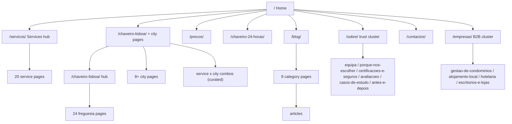
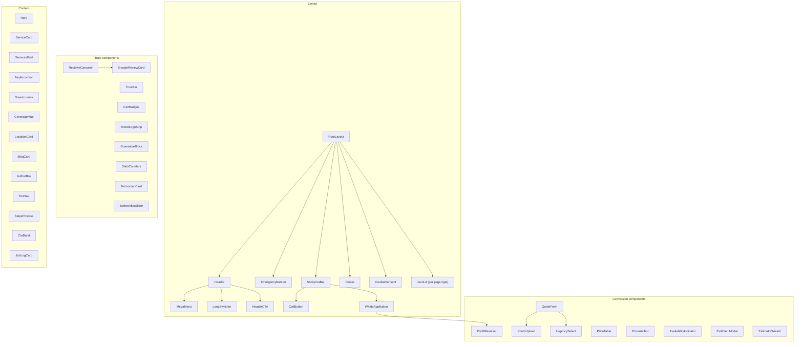

# 02 — Sitemap, Information Architecture, Navigation & Wireframes

> Index: [[00-index]] · Previous: [[01-strategy-and-research]] · Next: [[03-seo-architecture]]

---

## 1. Complete sitemap

Portuguese is the default locale at the root. Other locales live under `/en/`, `/es/`, `/fr/` with translated slugs (see doc 03 §6). All slugs below are the PT canonical versions.



### 1.1 Full URL inventory

**Core**

| URL | Page | Priority |
|---|---|---|
| `/` | Home | 1.0 |
| `/chaveiro-24-horas/` | 24/7 Emergency (also serves "Emergency Locksmith" intent — one page, both keywords, avoids cannibalization) | 1.0 |
| `/precos/` | Transparent price list | 0.9 |
| `/contactos/` | Contact | 0.8 |
| `/orcamento/` | Fast quote form (standalone, used as ad landing) | 0.8 |
| `/marcacao/` | Online booking (Phase 3) | 0.7 |

**Services — `/servicos/` hub + 20 pages** (H1 keyword / EN equivalent):

| URL | Service |
|---|---|
| `/servicos/abertura-de-portas/` | Door Opening (highest-intent head term in PT) |
| `/servicos/carro-trancado/` | Car Lockout |
| `/servicos/chaveiro-residencial/` | Residential Locksmith |
| `/servicos/chaveiro-comercial/` | Commercial Locksmith |
| `/servicos/chaveiro-automovel/` | Automotive Locksmith |
| `/servicos/instalacao-de-fechaduras/` | Lock Installation |
| `/servicos/substituicao-de-fechaduras/` | Lock Replacement |
| `/servicos/reparacao-de-fechaduras/` | Lock Repair |
| `/servicos/abertura-de-cofres/` | Safe Opening |
| `/servicos/reforco-de-seguranca/` | Security Upgrades |
| `/servicos/fechaduras-inteligentes/` | Smart Locks |
| `/servicos/fechaduras-digitais/` | Digital Locks (canonical-watch: if content overlaps smart locks, merge and 301) |
| `/servicos/fechaduras-alta-seguranca/` | High Security Locks |
| `/servicos/copia-de-chaves/` | Key Duplication |
| `/servicos/extracao-de-chave-partida/` | Broken Key Extraction |
| `/servicos/fechaduras-caixa-correio/` | Mailbox Locks |
| `/servicos/fechaduras-de-garagem/` | Garage Locks |
| `/servicos/fechaduras-de-estores/` | Shutter Locks (estores/portões) |
| `/servicos/mudanca-de-canhao/` | Cylinder Change (added — top PT search term, competitors miss it) |
| `/servicos/portas-blindadas/` | Security Doors (added — high-ticket PT demand) |

Note: "Emergency Locksmith" and "24/7 Emergency Locksmith" intents are consolidated into `/chaveiro-24-horas/` at root level (it is the money page — shortest URL, most internal links).

**Locations** (see doc 03 §4 for the programmatic model):

| URL pattern | Scope |
|---|---|
| `/chaveiro-lisboa/` | Lisbon hub (primary) |
| `/chaveiro-lisboa/{freguesia}/` | 24 Lisbon freguesias: alfama, baixa-chiado, alvalade, areeiro, arroios, avenidas-novas, beato, belem, benfica, campo-de-ourique, campolide, carnide, estrela, lumiar, marvila, misericordia, olivais, parque-das-nacoes, penha-de-franca, santa-clara, santa-maria-maior, santo-antonio, sao-domingos-de-benfica, sao-vicente |
| `/chaveiro-{cidade}/` | Cities: cascais, sintra, oeiras, amadora, almada, loures, odivelas, setubal (+ mafra, vila-franca-de-xira, seixal, barreiro in Phase 4) |
| `/{servico}-{cidade}/` | **Curated** service×city combos only where search volume justifies: `/abertura-de-portas-lisboa/`, `/abertura-de-portas-cascais/`, `/carro-trancado-lisboa/`, `/chaveiro-24-horas-lisboa/` … max ~15 at launch (doorway-page guardrail) |

**Blog — `/blog/` + 9 categories:**

`/blog/seguranca-domestica/` (Home Security) · `/blog/manutencao-de-fechaduras/` (Lock Maintenance) · `/blog/dicas-de-emergencia/` (Emergency Tips) · `/blog/seguranca-automovel/` (Car Security) · `/blog/seguranca-comercial/` (Commercial Security) · `/blog/fechaduras-inteligentes/` (Smart Locks) · `/blog/seguranca-em-viagem/` (Travel Safety) · `/blog/noticias/` (Portugal Security News) · `/blog/guias-de-compra/` (Buying Guides). Articles at `/blog/{slug}/` (category in breadcrumb, not URL — allows recategorizing without redirects).

**Trust cluster:**

`/sobre/` (About) · `/sobre/equipa/` (Team) · `/sobre/porque-nos-escolher/` (Why Choose Us) · `/sobre/certificacoes-e-seguros/` (Licenses + Certifications + Insurance — one page; PT has no MLA equivalent strong enough for three separate pages; expand later if content justifies) · `/avaliacoes/` (Reviews — root level, it's a conversion page) · `/casos-de-estudo/` + `/casos-de-estudo/{slug}/` (Case Studies) · `/antes-e-depois/` (Before & After gallery)

**B2B cluster:**

`/empresas/` (hub) · `/empresas/gestao-de-condominios/` (Property managers/condos) · `/empresas/alojamento-local/` (Airbnb/AL hosts — unique high-value page, zero competition) · `/empresas/hotelaria/` (Hotels) · `/empresas/escritorios-e-lojas/` (Offices & retail)

**Utility:** `/faq/` · `/politica-de-privacidade/` · `/termos-e-condicoes/` · `/livro-de-reclamacoes/` (mandatory PT link-out) · `/404` (with emergency CTA — lost users may still be locked out!)

Total at launch: ~95 indexable pages (PT) → ~380 including locales. Phase 4 grows locations + blog to 250+ PT pages.

---

## 2. Navigation architecture

### 2.1 Header (desktop)

```
[Logo]  Serviços ▾   Zonas ▾   Preços   Avaliações   Blog   Empresas   [☎ 963 000 000]  [WhatsApp]  [PT ▾]
```

- **Serviços ▾** — mega-menu, 3 columns: Emergência (24h, abertura de portas, carro trancado, extração de chave) / Casa (residencial, instalação, substituição, canhão, blindadas, smart locks) / Empresas & Auto (comercial, automóvel, cofres, estores, garagem) + footer row linking `/servicos/` and `/precos/`.
- **Zonas ▾** — Lisboa (+ top 6 freguesias), then city list, link to full coverage map.
- Phone shown as **text number** (memorable, matches GBP) styled as button. Language switcher: PT/EN/ES/FR, links to translated equivalent page (never just the homepage).

### 2.2 Mobile navigation

- Slim header: logo + ☎ icon + hamburger. Full-screen sheet menu with accordion sections; emergency block pinned at top of the menu ("🚨 Emergência? Ligue já").
- **Sticky bottom CTA bar** (the real navigation for 80% of users): `[📞 Ligar] [💬 WhatsApp]`.

### 2.3 Footer (site-wide, 5 columns)

1. Brand + NAP (exact GBP match) + NIF + license/insurance line + payment icons (MB Way, Multibanco, Visa/MC, cash) + Livro de Reclamações badge.
2. Serviços (top 8 + "ver todos").
3. Zonas (all cities + top freguesias — key internal-link surface).
4. Empresa (about, team, reviews, case studies, blog, contact, careers).
5. CTA block: phone, WhatsApp, email, hours ("24h, todos os dias"), social icons.
Bottom bar: © · privacy · terms · sitemap link · language links.

### 2.4 Breadcrumbs

On every page except home: `Início › Serviços › Abertura de Portas` / `Início › Chaveiro Lisboa › Alfama` / `Início › Blog › Segurança Doméstica › {artigo}`. Visible + `BreadcrumbList` schema.

---

## 3. Wireframes (section stacks, mobile-first)

Conventions: every template ends with `[FAQ accordion] → [Coverage/related links] → [Final CTA band] → [Footer]`; sticky CTA bar is global; emergency banner appears on all service/location/emergency pages.

### 3.1 Home `/`

```
┌─────────────────────────────────────┐
│ 🚨 Emergency banner (time-aware)     │
│ Header (slim, sticky)                │
├─────────────────────────────────────┤
│ HERO                                 │
│  H1: Chaveiro em Lisboa 24h —        │
│      Abertura de Portas em 20-30 min │
│  Sub: Preço fixo · Sem danos ·       │
│       Técnicos certificados          │
│  [📞 LIGAR AGORA]  [💬 WhatsApp]     │
│  ● Disponível agora · ★4.9 (n)      │
├─────────────────────────────────────┤
│ TRUST BAR: ★Google · Preço fixo ·   │
│  Segurado · MB Way/Cartão            │
├─────────────────────────────────────┤
│ SERVICES GRID (8 cards + ver todos)  │
│  icon · name · desde XX€ · seta      │
├─────────────────────────────────────┤
│ HOW IT WORKS (3 steps: Contacte →    │
│  Chegamos em 20-30min → Preço fixo)  │
├─────────────────────────────────────┤
│ WHY US (4 cols) + guarantees block   │
├─────────────────────────────────────┤
│ REVIEWS carousel (live Google) +     │
│  [Ver todas as avaliações]           │
├─────────────────────────────────────┤
│ COVERAGE MAP (interactive, lazy) +   │
│  city/freguesia link list            │
├─────────────────────────────────────┤
│ CERTIFICATIONS + lock-brand logos    │
├─────────────────────────────────────┤
│ PRICE TEASER (3 rows + /precos/)     │
├─────────────────────────────────────┤
│ FAQ (6) │ BLOG (3 cards) │ CONTACT   │
│ Footer                               │
└─────────────────────────────────────┘
│ [📞 Ligar]      [💬 WhatsApp]        │ ← sticky
```

### 3.2 Service page template `/servicos/{slug}/`

```
Breadcrumb
H1: {Serviço} em Lisboa · sub with benefit + ETA
[📞 Ligar] [💬 WhatsApp c/ mensagem pré-preenchida]
Price anchor: "Desde XX€ — preço confirmado antes de começar" → /precos/
────────────────────────────────
WHAT/WHEN: problem description, situations list (targets long-tail)
PROCESS: 3-4 steps with photos (real technicians)
PRICE TABLE (rows for this service: dia/noite/fim-de-semana)
TRUST: guarantee block + relevant certifications + brand logos
GALLERY: before/after (installation-type services) or job photos
REVIEWS: 3 filtered to this service
RELATED SERVICES (3 cards) · AREAS WE SERVE (city links → combos)
FAQ (5-8, service-specific) → Final CTA band → Footer
```

### 3.3 Emergency page `/chaveiro-24-horas/`

Same as service template but: red/urgent visual accent; hero adds **live availability indicator** and inline day/night price rows; process emphasizes "atendemos em 3 toques"; section "O que fazer enquanto espera" (safety tips — E-E-A-T + dwell time); anti-scam block ("Como evitar burlas de chaveiros — o que verificar"); NO exit-intent, NO estimator, minimal images.

### 3.4 City page `/chaveiro-{cidade}/`

```
Breadcrumb · H1: Chaveiro em {Cidade} — 24h
CTAs + ● ETA for this city ("Chegada média em {Cidade}: 25-35 min")
Local intro (unique copy: coverage, parking/access realities, common
  building/lock types in the area — genuinely local, not template filler)
SERVICES available (grid linking to service pages / combos)
MAP: Google Map embed centered on city + covered freguesias list
LANDMARKS strip: "Atendemos junto a {landmarks}" (natural copy)
LOCAL REVIEWS (filtered by city, with freguesia names)
RECENT JOBS in {cidade} (job-log entries — kills doorway-page risk)
NEARBY AREAS (sibling city links) · FAQ (city-specific: ETA, parking,
  night service in {cidade}) → CTA band → Footer
```

### 3.5 Freguesia page `/chaveiro-lisboa/{freguesia}/`

Compact variant of 3.4: unique 200–350-word local block (building stock: e.g. Alfama's historic doors/multibanco access vs Parque das Nações' smart buildings), ETA specific to freguesia, 2–3 local reviews, recent jobs, map pin, links up to Lisbon hub + 3 sibling freguesias. **Publish only with unique content ready — quality gate over quantity.**

### 3.6 Prices `/precos/`

Hero: "Preços fixos, sem surpresas" → full table grouped by service (columns: Dia 8h–21h / Noite / Fim-de-semana & feriados), "o preço inclui" list, payment methods, anti-scam comparison ("porque desconfiar de 'desde 9€'"), guarantee block, FAQ on pricing, CTAs throughout.

### 3.7 Blog article `/blog/{slug}/`

Breadcrumb · H1 · author box (real technician profile — E-E-A-T) · updated date · TOC (long posts) · body with contextual service-page links · inline CTA card after ~40% ("Precisa de ajuda com isto? …") · related articles · service cross-links · author schema. Category pages: intro copy (not bare lists) + article grid + category FAQ.

### 3.8 Contact `/contactos/`

Two columns (stacked mobile): left = instant channels (phone as huge button, WhatsApp, email, hours "24/7 — resposta noturna garantida", social); right = form (name, phone, service, urgency, message, photo upload, RGPD checkbox). Below: Google Map, NAP block, "Como chegar" (if physical shop), Livro de Reclamações link.

### 3.9 Trust pages

- **/sobre/**: story + owner photo + name (German pattern — faces beat stock photos), values, stats counters (anos, aberturas, avaliações), certifications, team teaser, CTA.
- **/sobre/equipa/**: technician cards — real photo, first name, certifications, years, freguesias covered, "verificado" badge. Feeds `Person` schema + author bylines.
- **/avaliacoes/**: live Google reviews (filterable by service/city), aggregate rating header, video testimonials, "Deixe a sua avaliação" CTA, review schema (of genuine on-site testimonials only — see doc 03 §5 caveat).
- **/casos-de-estudo/{slug}/**: challenge → solution → result + photos + client quote (B2B focus).
- **/antes-e-depois/**: filterable gallery, before/after slider component, each item links to its service page.

### 3.10 Quote `/orcamento/` (ad landing)

Distraction-reduced: slim header (logo + phone only), 3-step form with progress (1: serviço + urgência → 2: local + fotos → 3: contacto), trust sidebar (reviews, guarantees), no footer nav. Confirmation screen sets expectation ("Resposta em 15 min via WhatsApp") + fires `form_submit`.

---

## 4. Component hierarchy



**Template composition** (each page = layout + ordered section components):

| Template | Distinct components used |
|---|---|
| Home | Hero, TrustBar, ServicesGrid, StepsProcess, GuaranteeBlock, ReviewsCarousel, CoverageMap, CertBadges, PriceAnchor, FaqAccordion, BlogCards, ContactBlock |
| Service | ServiceHero, PriceTable, StepsProcess, BeforeAfterSlider, ReviewsCarousel(filtered), RelatedServices, AreaLinks, FaqAccordion |
| Location | LocalHero, AvailabilityIndicator, ServicesGrid(links), GoogleMap, LandmarkStrip, ReviewsCarousel(filtered), JobLogCards, SiblingLinks, FaqAccordion |
| Blog | AuthorBox, TocNav, InlineCtaCard, RelatedArticles |
| Contact/Quote | QuoteForm, ContactChannels, GoogleMap |

All conversion components read a shared `ConversionContext` (page type, service, city, locale) that resolves phone number, WhatsApp prefill, and analytics params — one implementation, contextual everywhere.

---

## 5. Mobile-first design requirements

1. Design at 360×800 first; desktop is the enhancement.
2. Sticky CTA bar: min 48px touch targets, `env(safe-area-inset-bottom)` padding, hidden while keyboard open.
3. Hero CTAs above the fold at 360px width with the emergency banner present — test this exact stack.
4. Base font ≥ 16px; phone numbers ≥ 20px semibold; never disable zoom.
5. All interactive elements ≥ 44×44px, ≥ 8px gaps.
6. FAQ, menus, galleries usable without JS where feasible (`<details>`, CSS scroll-snap).
7. Map components lazy-load on interaction (facade pattern) — Google Maps JS is a CWV killer.
8. Images: AVIF/WebP, `srcset`, explicit dimensions, hero preloaded, rest lazy.
9. One-thumb rule: every conversion action reachable in the bottom 60% of the screen.
10. Test matrix: iPhone SE/13/15, mid-range Android (Samsung A-series), Chrome + Safari, 4G throttled.
