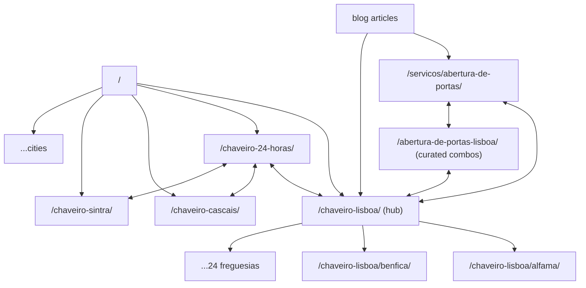

# 03 — SEO Architecture

> Index: [[00-index]] · Previous: [[02-information-architecture]] · Next: [[04-technical-architecture]]

Research finding driving this whole document: **no top-ranking locksmith competitor in PT, UK, US, DE, or AU had meaningful structured data, hreflang, or topical content depth** (see [[01-strategy-and-research#1.2 Market-wide gaps (our unfair advantages)]]). Technical SEO executed properly is the moat.

---

## 1. Site-wide technical SEO

| Item | Specification |
|---|---|
| Semantic HTML | One `<h1>` per page; landmark elements (`header/nav/main/aside/footer`); `<article>` for posts/reviews; FAQ as `
/
`; phone numbers as `<a href="tel:+351...">` |
| Canonical URLs | Self-referencing absolute canonical on every page; trailing-slash enforced; `www`→apex 301; http→https; strip query params (`?utm_*`) via canonical |
| Breadcrumbs | Visible + `BreadcrumbList` JSON-LD, on all pages except home |
| XML sitemaps | Index at `/sitemap.xml` → `sitemap-pages.xml`, `sitemap-services.xml`, `sitemap-locations.xml`, `sitemap-blog.xml` per locale; `<lastmod>` from CMS; auto-regenerated on publish |
| Robots.txt | Allow all; disallow `/api/`, `/admin/`, `/orcamento/obrigado/` (thank-you pages `noindex` too); sitemap reference |
| Pagination | Blog category pagination with `rel` self-canonicals per page (never canonical to page 1) |
| 404 | Custom, with emergency CTA + search + top links; returns real 404 status |
| Redirects | 301 map maintained in CMS; monitor 404s in Search Console monthly |

## 2. Meta templates

| Page type | Title template (≤ 60 chars) | Description template (≤ 155 chars) |
|---|---|---|
| Home | `Chaveiro Lisboa 24h · Abertura de Portas em 20-30 min · {Brand}` | `Chaveiro em Lisboa 24 horas. Preços fixos publicados, técnicos certificados, chegada em 20-30 min. ★4.9 no Google. Ligue {phone} ou WhatsApp.` |
| Service | `{Serviço} em Lisboa desde {preço}€ · 24h · {Brand}` | `{Serviço} em Lisboa e arredores. Preço fixo desde {preço}€, sem surpresas. Chegada em 20-30 min, 24/7. Garantia de 12 meses. Ligue ou envie WhatsApp.` |
| City | `Chaveiro em {Cidade} 24 Horas · Chegada {ETA} min · {Brand}` | `Chaveiro em {Cidade}: abertura de portas, fechaduras e emergências 24h. Chegada média {ETA} min. Preços fixos. ★4.9. Ligue {phone}.` |
| Freguesia | `Chaveiro {Freguesia}, Lisboa · 24h em {ETA} min · {Brand}` | localized variant with freguesia + nearby landmark |
| Combo | `{Serviço} em {Cidade} · 24h · Desde {preço}€ · {Brand}` | service+city variant |
| Blog | `{Título do artigo} · Blog {Brand}` | article-specific, hand-written, with CTA verb |
| Prices | `Preços de Chaveiro em Lisboa 2026 · Tabela Completa · {Brand}` | `Tabela de preços transparente: abertura de portas desde {X}€, mudança de canhão desde {Y}€. Dia, noite e fim-de-semana. Sem taxas escondidas.` |

Open Graph + Twitter Cards on all pages: `og:type` (website/article), `og:locale` + alternates, per-template OG image (1200×630, generated: service icon + price + rating on brand background), `twitter:card=summary_large_image`.

## 3. Structured data (JSON-LD)

Injected server-side per template; all IDs use stable `@id` URIs (`https://{domain}/#organization` etc.) so graphs interlink.

| Schema | Where | Key properties |
|---|---|---|
| **`Locksmith`** (LocalBusiness subtype) | Site-wide (home + footer graph) | `name`, `image`, `logo`, `url`, `telephone`, `email`, `address` (exact GBP match!), `geo`, `openingHoursSpecification` (24/7: `Mo-Su 00:00-23:59`), `areaServed` (City list), `priceRange` (`€€`), `paymentAccepted`, `vatID` (NIF), `aggregateRating` (only if reviews are on-page), `sameAs` (GBP, Facebook, Instagram) |
| `Service` | Every service page | `serviceType`, `provider` → `@id` org, `areaServed`, `offers` → `Offer` with `priceSpecification` (from price table — matches visible prices), `hasOfferCatalog` on hub |
| `FAQPage` | Any page with FAQ accordion | mirror visible Q&A exactly |
| `BreadcrumbList` | All pages | matches visible trail |
| `Review` / `AggregateRating` | `/avaliacoes/`, service/location pages | **Only first-party testimonials collected and displayed on-site.** Do not mark up Google-sourced reviews (against Google guidelines — self-serving review markup from third-party widgets can trigger manual actions). Google reviews are displayed unmarked; on-site testimonial system feeds the markup |
| `Article` + `Person` (author) | Blog | author → technician `Person` with `jobTitle`, `knowsAbout`, linked from `/sobre/equipa/` |
| `HowTo` | Selected blog guides | e.g. "como mudar um canhão" |
| `WebSite` | Home | `potentialAction: SearchAction` (if site search added) |
| `VideoObject` | video testimonials / job videos | |

**Consistency rule:** NAP in schema = footer = GBP = every directory citation, character-for-character. Mismatches can suspend the GBP listing.

## 4. Local SEO & programmatic location pages

### 4.1 Hub-and-spoke cluster model

### 4.2 Anti-doorway guardrails (hard rules)

Google's John Mueller has explicitly flagged mass templated location pages as doorway pages. Rules:

1. **≥ 30% genuinely unique content per location page**: local building-stock notes, real ETA, local reviews, recent-job entries, freguesia-specific FAQ. ~70% shared structure is acceptable.
2. **Publish gated on content**: a location page ships only when it has the unique block + ≥ 2 local reviews or job entries. Launch with Lisbon hub + 8 freguesias + 4 cities; grow monthly.
3. Combos (`/{servico}-{cidade}/`) capped at ~15, only for proven query volume.
4. Every location page must be reachable ≤ 3 clicks from home (footer + hub links).
5. If two pages compete for one query in Search Console → consolidate and 301.

### 4.3 Google Business Profile strategy

- Primary category **Locksmith/Serralheiro**; secondary: Emergency locksmith service. Service-area business covering listed municipalities.
- All attributes filled; services list mirrors site services with prices; products for smart-lock installs.
- Weekly GBP posts (job highlights, tips); Q&A seeded with the site FAQ; photos monthly (real jobs, team, vans).
- UTM-tagged website link (`?utm_source=gbp`) → GA4 attribution.
- Review velocity: automated post-job requests (WhatsApp template + SMS fallback) targeting reviews that mention **service + freguesia** ("Abriram a minha porta em Alvalade às 2h da manhã…") — local-relevance gold.
- Citations: consistent NAP on Páginas Amarelas, Yelp PT, Infobel, CustoJusto, Facebook, Zaask/Fixando + niche directories.

## 5. Keyword & content architecture

### 5.1 Keyword cluster → page mapping

| Cluster (head terms) | Target page |
|---|---|
| `abertura de portas lisboa`, `abrir porta trancada` | `/servicos/abertura-de-portas/` + Lisbon combo |
| `chaveiro lisboa`, `serralheiro lisboa 24 horas`, `chaveiro perto de mim` | `/chaveiro-lisboa/` + home |
| `chaveiro 24 horas`, `chaveiro urgente`, `serralheiro urgência` | `/chaveiro-24-horas/` |
| `mudar canhão fechadura preço`, `mudança de canhão` | `/servicos/mudanca-de-canhao/` + `/precos/` |
| `carro trancado chave dentro`, `abrir carro fechado` | `/servicos/carro-trancado/` |
| `fechadura inteligente portugal`, `fechadura eletrónica preço` | `/servicos/fechaduras-inteligentes/` + buying guides |
| `chaveiro {cidade}` × 8+ cities | city pages |
| `locksmith lisbon`, `emergency locksmith lisbon`, `locked out lisbon airbnb` | `/en/` equivalents (zero competition) |
| informational long-tail (`como abrir porta fechada`, `fechadura presa chave não roda`) | blog → internal links to service pages |

Note: target *both* "chaveiro" and "serralheiro" — used interchangeably in PT SERPs; primary entity name uses "chaveiro", copy naturally includes "serralheiro" variants.

### 5.2 Topical authority plan (blog)

- Cadence: 4 posts/month first 6 months, then 2–4. Every post: technician author byline, ≥ 1 original photo, 2–4 internal links to service/location pages, FAQ block.
- Pillar guides (2,500+ words) per category, e.g. "Guia completo de segurança doméstica em Portugal (2026)" → cluster posts link up to the pillar, pillar links down.
- **Job-log stream** ("Trabalhos Recentes"): 2–3 short posts/week — photo, freguesia, problem, solution, time-to-complete. Feeds location pages, E-E-A-T, and image search. Cheapest highest-ROI content in this vertical (UK pattern).
- E-E-A-T mechanics: technician `Person` pages with credentials; "reviewed by" lines on technical guides; cite DGEG/PSP/DECO sources in security content; updated dates maintained.

## 6. Multilingual SEO (PT default, EN/ES/FR)

- Path-prefix strategy: `/` (pt-PT), `/en/`, `/es/`, `/fr/`. Translated slugs: `/en/services/door-opening/`, `/en/locksmith-lisbon/alfama/`.
- `hreflang` full mesh incl. `x-default` → PT; only between truly translated equivalents (never hreflang to untranslated fallbacks — untranslated pages simply don't exist in that locale).
- EN locale gets extra tourist/Airbnb content: `/en/locked-out-in-lisbon/`, `/en/airbnb-hosts/`. ES/FR launch with core 25 pages (home, emergency, top services, Lisbon hub, prices, contact), grow by demand.
- Locale-aware everything: WhatsApp prefill language, phone answer scripts, GA4 `locale` dimension, per-locale OG images.

## 7. Core Web Vitals & image SEO

Targets (p75 mobile): **LCP < 2.0 s · INP < 200 ms · CLS < 0.05**.

- Hero: no image carousel; single optimized AVIF/WebP with `fetchpriority="high"` + preload, or CSS gradient background (fastest).
- Fonts: max 2 families, `font-display: swap`, self-hosted subsets, preloaded.
- Third-party discipline: GTM loads after consent/interaction where possible; Google Maps behind click-facade; review widget server-rendered from cached data (no third-party JS); WhatsApp widget is a plain styled link (no vendor script).
- Explicit width/height (or aspect-ratio) on all media; reserve space for banners → CLS ~0.
- Lazy-load below-fold images/iframes (`loading="lazy"`); never lazy-load LCP element.
- Image pipeline: CMS-uploaded originals → on-demand resize to AVIF/WebP at 6 breakpoints, descriptive filenames (`abertura-porta-blindada-alfama.avif`), PT alt text, EXIF-stripped. Full plan: [[04-technical-architecture#6. Performance optimization plan]].

## 8. Internal linking rules (enforced by templates)

1. Every service page links: hub, 3 related services, 5+ location/combo pages, `/precos/`, 1–2 blog posts.
2. Every location page links: parent hub, 3 siblings, 6 top services, emergency page.
3. Every blog post links: ≥ 2 service pages, ≥ 1 location page, pillar.
4. Footer carries the location cluster (biggest sitewide link surface).
5. Emergency page `/chaveiro-24-horas/` receives links from **every** template (highest-value page).
6. Anchor text varies naturally (exact / partial / branded) — no sitewide identical anchors.
7. Orphan-page check in CI: every indexable URL must have ≥ 3 internal inlinks.
