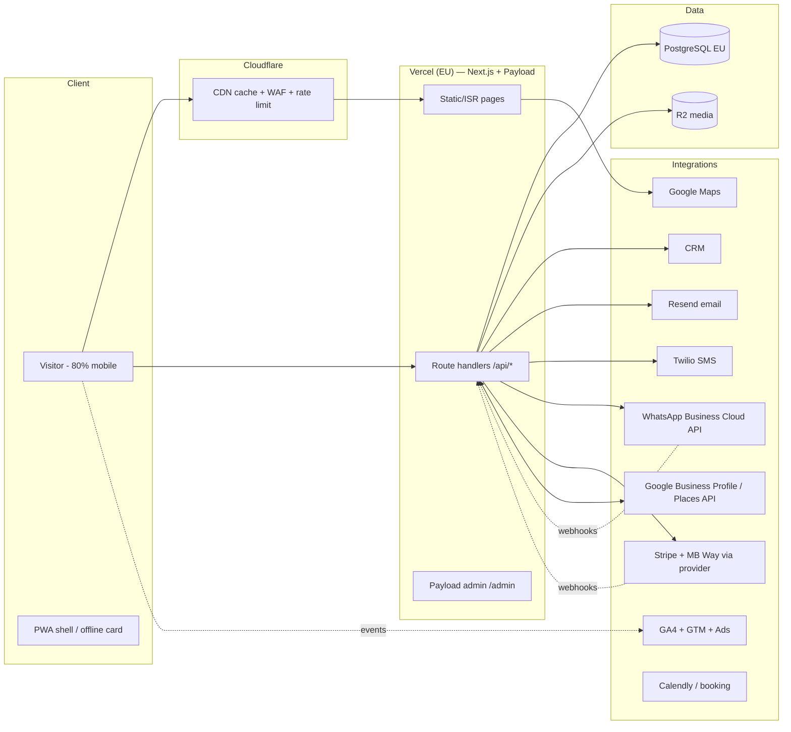
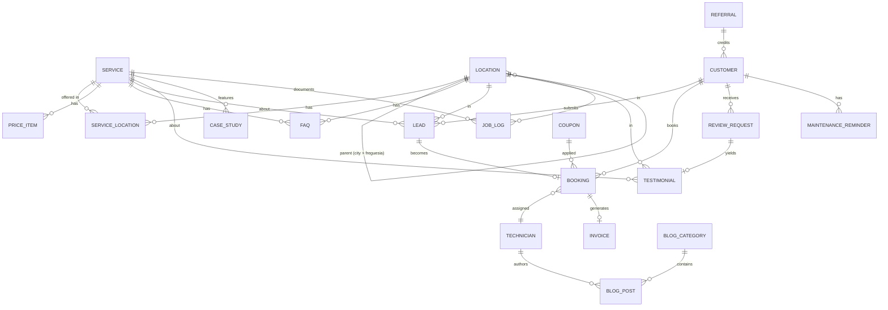

# 04 — Technical Architecture

> Index: [[00-index]] · Previous: [[03-seo-architecture]] · Next: [[05-roadmap-and-features]]

---

## 1. Recommended technology stack

| Layer | Choice | Rationale |
|---|---|---|
| Frontend | **Next.js 15+ (App Router, React, TypeScript)** | SSG/ISR for ~380 mostly-static SEO pages, server components = minimal JS, first-class i18n routing, image optimization built in |
| Styling/UI | Tailwind CSS + shadcn/ui + Lucide icons | Fast to build, tiny CSS, accessible primitives |
| i18n | `next-intl` | Translated slugs, locale routing, hreflang helpers |
| CMS | **Payload CMS 3** (embedded in the Next.js app) | Self-hosted (GDPR/EU data residency), free, TypeScript-native, runs in the same repo/deployment, localization built in, gives admin UI for services/locations/prices/posts/leads. Alternative if a SaaS admin is preferred: Sanity |
| Database | **PostgreSQL** (managed: Neon or Supabase, EU region) | Relational fits the entity model; Payload adapter; PostGIS available later for geo queries |
| Hosting | **Vercel (fra1/cdg1 EU regions)** | Best Next.js DX, ISR, preview deploys. Cost-control alternative: Hetzner + Coolify (self-host, same containers) |
| CDN / DNS / WAF | **Cloudflare** in front (DNS, WAF, bot protection, rate limiting) | Locksmith is a click-fraud/scraper-heavy vertical; WAF + rate limits on lead APIs |
| Caching | Static generation + ISR (content pages, revalidate on CMS publish via webhook); Cloudflare edge cache for assets; Redis (Upstash) only when booking/availability arrives (Phase 3) | |
| Media | Cloudflare R2 (originals) + Next/Image or Cloudflare Images for on-demand AVIF/WebP variants | |
| Forms/leads | Next.js route handlers → Postgres + CRM webhook + notifications | No third-party form SaaS (GDPR + speed) |
| Email | Resend or Postmark (transactional), EU-compliant | Confirmations, quote replies |
| SMS | Twilio (or PT-local: GatewayAPI/Vonage) | Job confirmations, review requests fallback |
| Analytics | **GA4 + GTM** (+ optional server-side GTM later); Vercel Speed Insights / CrUX for CWV | Consent Mode v2 mandatory (EU) |
| Cookie consent | CMP with Google Consent Mode v2 (Cookiebot / CookieYes / Usercentrics) | Contact CTAs must work pre-consent |
| Monitoring | Sentry (errors) + UptimeRobot/Better Stack (uptime + `tel:`-critical page checks) + Search Console + GA4 alerts | A down site at 2 a.m. = lost emergency jobs; alert to owner's phone |
| Backups | Managed Postgres PITR (daily snapshot, 30-day retention) + weekly R2 media sync + CMS config in git | Restore drill quarterly |
| PWA | Manifest + service worker (offline shell showing phone/WhatsApp + cached emergency page) | "Locked out with 3% battery" — offline emergency card is a real differentiator |

**Rendering strategy per template:** Home/services/locations/trust/prices = SSG + ISR (revalidate on publish). Blog = ISR. Quote/booking/estimator = client islands on static shells. Admin = Payload (dynamic). Availability indicator = tiny edge endpoint, client-fetched, cached 60 s.

---

## 2. System architecture

---

## 3. Database entities (ERD)

| Entity | Key fields (beyond id/timestamps) |
|---|---|
| `Service` | slug (localized), name, excerpt, body (blocks), icon, heroImage, priceFrom, relatedServices[], seo{title,description,ogImage}, published |
| `Location` | slug, name, type(city/freguesia), parent→Location, geo{lat,lng}, etaMin/etaMax, localContent (blocks), landmarks[], mapEmbed, uniqueContentReady (publish gate), seo{} |
| `ServiceLocation` | service, location, published, uniqueIntro, priceOverride — powers curated combo pages |
| `PriceItem` | service, label, dayPrice, nightPrice, weekendPrice, unit, includes[], visible |
| `Lead` | channel(call/whatsapp/form/booking/estimator), service?, location?, name, phone, email?, message, photos[], urgency, locale, status(new/contacted/quoted/won/lost), utm{source,medium,campaign,gclid}, consentAt |
| `Customer` | name, phone (unique), email?, locale, marketingConsent, source, tags(b2b/airbnb/residential) |
| `Booking` | lead?, customer, service, location, slotStart/End, technician, status, priceQuoted, couponCode?, notes |
| `Technician` | name, photo, bio, certifications[], yearsExperience, areas[]→Location, active — feeds team page + author bylines |
| `Testimonial` | customer name, rating, text, service?, location?, source(onsite/google-display-only), verified, publishable — only `onsite` gets Review schema |
| `ReviewRequest` | booking, channel(whatsapp/sms/email), sentAt, clickedAt, reviewedAt |
| `BlogPost` | slug, title, category, author→Technician, body, toc, relatedServices[], locale versions, publishedAt, updatedAt |
| `JobLog` | date, service, location, summary, photos[], durationMin, publishable — feeds location pages + job-log stream |
| `CaseStudy` | slug, client type, challenge/solution/result, photos, quote, services[] |
| `FAQ` | question, answer, attachedTo(service/location/page), order, locale versions |
| `Invoice` | booking, number (sequential, legal PT requirements — issue via certified invoicing API e.g. InvoiceXpress/Moloni, store reference only), total, vat, paidVia(mbway/card/cash), pdfUrl |
| `Coupon` / `Referral` | code, discount, validity, usage caps / referrer→Customer, reward status |
| `MaintenanceReminder` | customer, service, dueAt, channel, sentAt |
| `ConversionEvent` | (optional server-side mirror of GA4 key events for call-tracking reconciliation) |

CMS-managed singletons: `SiteSettings` (NAP, phones per area, WhatsApp numbers, hours, social, badges), `Navigation`, `PriceTablePage`, `Redirects`.

---

## 4. API architecture

All under `/api/*` (Next.js route handlers). Public endpoints rate-limited (Cloudflare + token bucket) and bot-protected (Turnstile on forms).

| Endpoint | Method | Purpose |
|---|---|---|
| `/api/leads` | POST | Quote/contact form → validate (zod) → persist → CRM webhook → notify ops (WhatsApp/SMS/email) → auto-reply to customer |
| `/api/uploads` | POST | Signed upload for lead photos (size/type-limited, virus-scanned) |
| `/api/estimate` | POST | Instant estimator: rules engine over `PriceItem` → range + CTA; logs as lead-lite |
| `/api/availability` | GET | Current status + ETA per location (from ops config/on-call calendar); cached 60 s at edge |
| `/api/booking/slots` | GET | Available slots (Phase 3; own engine or Calendly proxy) |
| `/api/booking` | POST | Create booking → confirmations (email+SMS/WA) |
| `/api/reviews` | GET | Cached Google reviews (server fetches Places API on cron, stores snapshot — no client-side third-party JS) |
| `/api/webhooks/whatsapp` | POST | WA Cloud API inbound: auto-replies, after-hours flows, message→Lead |
| `/api/webhooks/stripe` | POST | Payment confirmations → invoice + receipt |
| `/api/webhooks/cms` | POST | Payload publish → ISR revalidate + sitemap regen |
| `/api/track` | POST | First-party conversion event mirror (sendBeacon) for call/WA attribution reconciliation |
| Cron jobs | — | nightly: reviews sync, sitemap ping, maintenance reminders due, review-request dispatch (2 h post-completion), backup verification |

Conventions: JSON, zod-validated, problem+json errors, idempotency keys on webhooks, all PII writes logged for GDPR audit, EU-only processing.

---

## 5. Integrations map

| Integration | How | Phase |
|---|---|---|
| WhatsApp Business | Phase 1: `wa.me` deep links. Phase 2: **Cloud API** (webhooks, auto-reply, templates for confirmations/review requests/reminders) | 1→2 |
| Google Maps | Static map image by default; interactive JS map behind click-facade on location/contact pages | 1 |
| Google Business Profile | Manual excellence + Places API review sync; GBP posts workflow | 1 |
| GA4 + GTM | Consent Mode v2; dataLayer spec in [[01-strategy-and-research#4.2 GA4 / GTM event schema]]; server-side GTM optional Phase 4 | 1 |
| Search Console | Both domain property + sitemap; monthly query/cannibalization review | 1 |
| Google Reviews | Places API cached server-side; review-request automation links to GBP write-review URL | 1–2 |
| Cloudflare | DNS, CDN, WAF, Turnstile, rate limiting, R2 | 1 |
| Stripe | Payment links for remote/Airbnb-host payments + deposits; **add MB Way/Multibanco via local PSP (eupago/IfThenPay/SIBS) — mandatory for PT trust** | 2–3 |
| Calendly | Interim booking for non-urgent installs (embed on `/marcacao/`), replaced by native booking Phase 3 | 2 |
| CRM | Start: Payload leads board + Google Sheets export. Scale: HubSpot Free or EspoCRM (self-hosted) via webhook | 2 |
| Email marketing | Resend/Brevo — transactional first; seasonal security-tips list later (double opt-in) | 2–3 |
| Live chat / AI chatbot | Phase 3: AI assistant (Claude API) as website concierge — triage (emergency→call/WA now; non-urgent→quote), answers from site content (prices, ETAs, services), captures lead into `/api/leads`, hands off to WhatsApp. After-hours first responder | 3 |
| Invoicing | InvoiceXpress/Moloni API (PT-certified) for legal digital invoices | 2 |
| Call tracking | CallRail-style dynamic number insertion (keep GBP primary number static!) | 3 |

---

## 6. Performance optimization plan

Budget (mobile p75): **LCP < 2.0 s · INP < 200 ms · CLS < 0.05 · JS shipped < 150 KB gz on content pages · HTML+CSS critical path < 100 KB**.

1. Server components by default; client islands only for: sticky bar handlers, forms, carousel, map facade, estimator, exit-intent.
2. Static/ISR everything indexable — TTFB from CDN cache.
3. Hero LCP: preloaded AVIF or gradient; no carousels above the fold.
4. Fonts: 2 self-hosted subset WOFF2, preloaded, `swap`.
5. Third-party: GTM after consent; zero third-party scripts on the critical path; review data server-cached; maps click-loaded.
6. `srcset` + AVIF/WebP + explicit dimensions everywhere; below-fold lazy.
7. Route-level code splitting (App Router default); no barrel-file bloat; bundle-analyze in CI.
8. CI gates: Lighthouse CI on home/service/location/emergency templates — fail build if perf < 90 or budgets exceeded; CWV field monitoring via CrUX dashboard + Search Console.
9. PWA: precache shell + emergency page + offline card (phone/WA links work offline via `tel:`/`wa.me`).

## 7. Security checklist

- [ ] HTTPS everywhere, HSTS preload; TLS 1.2+.
- [ ] Security headers: CSP (nonce-based, GTM allowlisted), X-Content-Type-Options, X-Frame-Options/frame-ancestors, Referrer-Policy, Permissions-Policy.
- [ ] Cloudflare WAF + bot fight mode; rate limits on `/api/leads`, `/api/estimate`, `/api/booking` (lead-spam is endemic in this vertical).
- [ ] Turnstile (invisible CAPTCHA) on all forms; honeypot field as second layer.
- [ ] Input validation (zod) server-side on every endpoint; file-upload type/size limits + AV scan; images re-encoded on ingest (strips payloads + EXIF/GPS of customer photos).
- [ ] Payload admin: 2FA, strong password policy, role-based access (admin/editor/ops), `/admin` optionally IP-allowlisted or behind Cloudflare Access.
- [ ] Webhook signature verification (Meta, Stripe, CMS) + idempotency.
- [ ] Secrets in platform env vault; never in repo; rotation on staff change.
- [ ] Dependency scanning (Dependabot/Renovate + `npm audit` in CI); lockfile pinned.
- [ ] **GDPR/RGPD:** lawful-basis mapping for leads (contract/legitimate interest) vs marketing (consent); privacy policy in all 4 languages; DPA with all processors (EU/SCC); data retention policy (leads 24 months, then anonymize); right-to-erasure runbook; consent records stored with timestamp+source; cookie CMP with Consent Mode v2; no PII to GA4 (phone numbers hashed if sent server-side).
- [ ] PITR backups tested quarterly (actual restore drill); incident-response contact card.
- [ ] Uptime + SSL-expiry + domain-expiry monitoring with phone alerts (site down at night = direct revenue loss).

## 8. Accessibility checklist (WCAG 2.2 AA)

- [ ] Color contrast ≥ 4.5:1 text, 3:1 UI/large text — including white-on-green CTA buttons (verify the WhatsApp green! `#25D366` fails with white text — use dark text or darkened variant).
- [ ] Full keyboard operability: mega-menu, accordions, carousel, modals (focus trap + ESC), skip-to-content link.
- [ ] Visible focus indicators (2.4.11 focus-appearance aware); focus not obscured by sticky bars (2.4.12).
- [ ] Touch targets ≥ 24×24 CSS px minimum (2.5.8) — ours are ≥ 44 anyway.
- [ ] Semantic landmarks + heading hierarchy; one h1; nav labeled (`aria-label="principal"` / `"rodapé"`).
- [ ] Forms: visible labels (no placeholder-as-label), error identification + suggestions, `autocomplete` attributes (2.5.7-friendly), no cognitive tests (3.3.8) — Turnstile is invisible.
- [ ] `lang` per locale; `hreflang`-consistent; screen-reader-tested language switcher.
- [ ] Alt text policy: descriptive PT/locale alt on informative images, empty alt on decorative; before/after slider keyboard + SR accessible.
- [ ] `prefers-reduced-motion` respected (pulse animations, counters, carousel autoplay off).
- [ ] Live regions for form submit feedback and availability indicator updates.
- [ ] Video testimonials: captions + transcript.
- [ ] CI: axe-core automated checks + manual audit per template before launch; test with VoiceOver (iOS) — emergency users include elderly and stressed users; accessibility is conversion here, not compliance.
