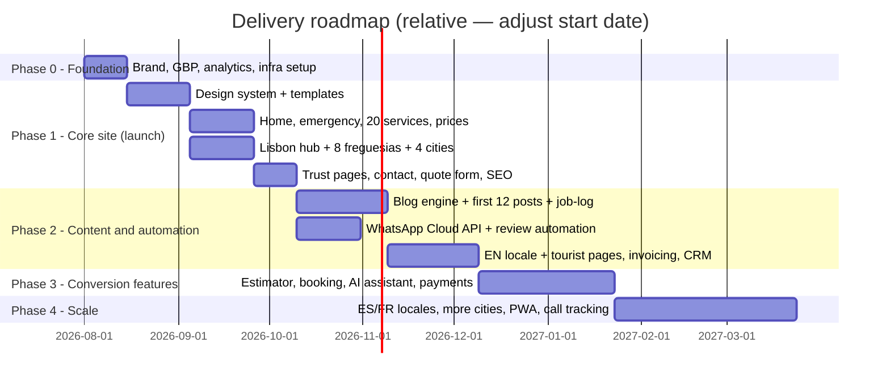

# 05 — Implementation Phases, Extra Features & Scalability Roadmap

> Index: [[00-index]] · Previous: [[04-technical-architecture]]

---

## 1. Implementation phases

### Phase 0 — Foundation (2 weeks)
Brand + domain decision; **Google Business Profile claimed and fully built** (starts ranking momentum before the site); phone + WhatsApp Business numbers provisioned; GA4/GTM/Search Console/Cloudflare accounts; repo + CI/CD + staging; price table finalized with owner (the transparency pillar depends on it); photo shoot booked (team, vans, real jobs — no stock).

### Phase 1 — Core site = launchable business (6–8 weeks)
Design system; all conversion components (sticky bar, WhatsApp widget with prefills, emergency banner, availability indicator); Home, `/chaveiro-24-horas/`, 20 service pages, `/precos/`, Lisbon hub + 8 freguesias + Cascais/Sintra/Oeiras/Amadora, trust cluster, contact + quote form (`/api/leads` → notifications); full SEO layer (schema, sitemaps, meta templates, breadcrumbs); Lighthouse/axe CI gates; GA4 events live. **Launch gate: p75 mobile LCP < 2 s on emergency page; all CTAs tracked; NAP identical everywhere.**

### Phase 2 — Content & automation (6–8 weeks)
Blog + 9 categories + 12 cornerstone posts + job-log stream; WhatsApp Cloud API (auto-replies, after-hours flow); review-request automation (2 h post-job, WA→SMS fallback); remaining freguesias/cities as unique content becomes ready; EN locale + Airbnb/tourist landing pages; certified invoicing; CRM pipeline; Calendly interim booking; email confirmations.

### Phase 3 — Conversion features (6–8 weeks)
Instant estimator, native booking with slots, AI assistant (triage + multilingual concierge, after-hours first responder), Stripe + MB Way payment links, exit-intent + coupon engine, customer notifications suite (SMS/WA status updates).

### Phase 4 — Scale (ongoing)
ES/FR locales; Setúbal + additional cities (Mafra, VFX, Seixal, Barreiro…); PWA offline emergency card; dynamic call tracking; customer dashboard, loyalty/referral programs; server-side GTM; CRO experimentation program (see §3).

---

## 2. Extra features — specs & priority

| Feature | Spec | Priority |
|---|---|---|
| **Instant price estimator** | 3-step wizard (service → situation details → range from `PriceItem` rules) ending in "preço fixo confirmado por WhatsApp" CTA; logs estimate as lead-lite; on planned-work pages only (never emergency) | P1 (Phase 3) |
| **Emergency response indicator** | Live "● Disponível agora · chegada ~{X} min em {area}" from ops config + on-call calendar; honest states (night surcharge notice) | P0 (Phase 1) |
| **Service availability checker** | Freguesia/city selector → coverage + ETA + correct phone; doubles as internal-link hub | P1 |
| **AI assistant** | Claude-powered concierge: triage (emergency → push to call/WA immediately, never chat-delay an emergency), quotes from price data, 4 languages, after-hours lead capture; escalation to human WhatsApp | P1 (Phase 3) |
| **Online booking** | Non-urgent services only; slots from technician calendars; deposit option via payment link; SMS/WA/email confirmations + reminder | P1 (Phase 3) |
| **Photo upload for lock issues** | On quote form + WhatsApp flow; speeds accurate quotes; images re-encoded, GPS EXIF stripped | P0 (Phase 1 form, Phase 2 WA) |
| **SMS notifications** | Booking confirmed / technician en route (name + photo + ETA — big trust moment) / job complete + invoice link | P1 |
| **Email confirmations** | Transactional mirror of SMS/WA for forms, bookings, invoices | P0 |
| **Digital invoices** | PT-certified provider API; PDF link via WA/SMS/email; card/MB Way receipt attached | P1 (Phase 2) |
| **Customer dashboard** | Phase 4; magic-link login (phone OTP); history, invoices, reminders, referral code. B2B version: multi-property view for property managers/AL hosts — genuinely differentiating | P2 |
| **Maintenance reminders** | 12 months post-install: "revisão da fechadura" WA/email (opt-in); cron-driven | P2 |
| **Loyalty program** | Simple: 3rd job −10%; tracked on Customer record | P3 |
| **Referral program** | Unique codes; both sides get €10 off; landing `/indique-um-amigo/` | P2 |
| **Coupon system** | Codes on bookings/exit-intent/seasonal campaigns; usage caps; GA4 campaign tie-in | P2 |
| **Review request automation** | 2 h post-completion: WA template → GBP review link; SMS fallback at 24 h; no-review → gentle single retry at 7 d; dashboard of request→review conversion | P0 (Phase 2 — fuels the entire local SEO flywheel) |

## 3. CRO experimentation program (post-launch)

Monthly test cadence, one variable at a time, on the highest-traffic template. Backlog seeded from research: hero headline (speed-led vs price-led vs trust-led) · sticky bar layout (call-only vs call+WA vs call+WA+quote) · price anchor position · review widget placement · emergency banner copy day vs night · WhatsApp prefill variants (measured via `prefill_variant` param). Measure against `click_call + click_whatsapp + form_submit` composite. Tooling: GA4 experiments via GTM or Vercel Edge Middleware A/B (no client-side flicker).

## 4. Future scalability roadmap

| Horizon | Expansion | Architecture already supports it via |
|---|---|---|
| 6–12 mo | Porto metro launch (`/chaveiro-porto/` + freguesias) | Location tree is hierarchical + publish-gated; just add content + GBP #2 |
| 6–12 mo | Franchise/partner technicians per zone | `Technician.areas[]`, per-area phone routing, lead assignment |
| 12–18 mo | National coverage (Algarve, Coimbra, Braga) | Same programmatic model; sitemap partitioning in place |
| 12–18 mo | Adjacent services (portas blindadas showroom, CCTV, alarmes) | `Service` taxonomy + B2B cluster extensible; consider separate topical hub if it dilutes locksmith relevance |
| 18+ mo | Marketplace/dispatch platform (multiple crews, live GPS "technician en route" tracking) | Booking + Technician entities; add Redis + realtime channel |
| 18+ mo | Native app for B2B clients (property managers) | API-first route handlers already expose the needed endpoints |
| Continuous | Content moat: 250+ blog posts, job-log archive, ES/FR full coverage | CMS localization + author system in place |

**Guardrails while scaling:** never let templated pages outpace unique content (doorway risk); keep one GBP per genuine physical presence/service area (no fake storefronts — the #1 spam pattern Google hunts in this exact vertical); re-verify NAP consistency quarterly; CWV budgets enforced in CI forever.
